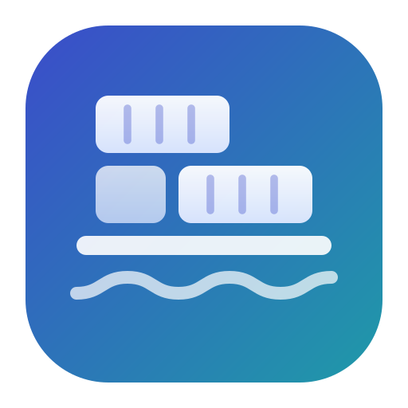
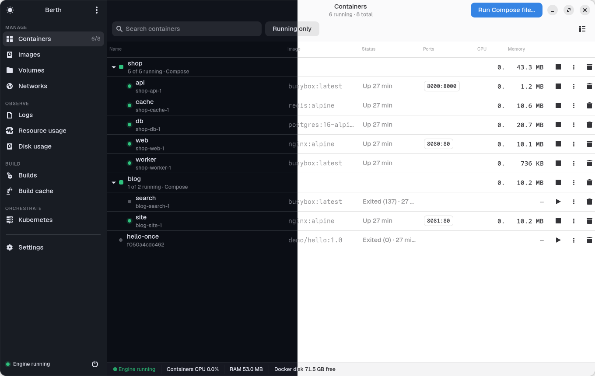
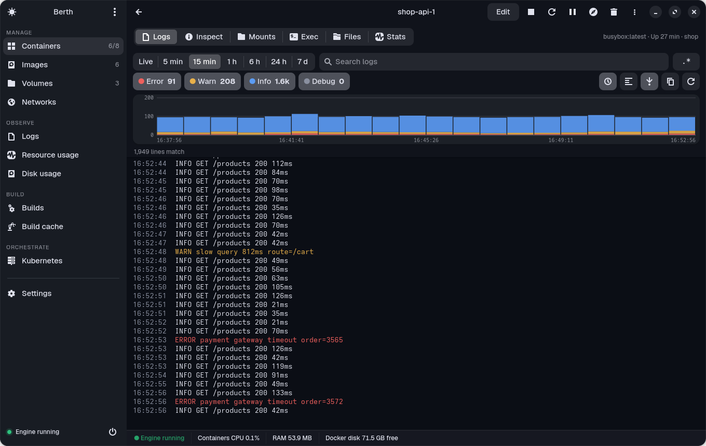
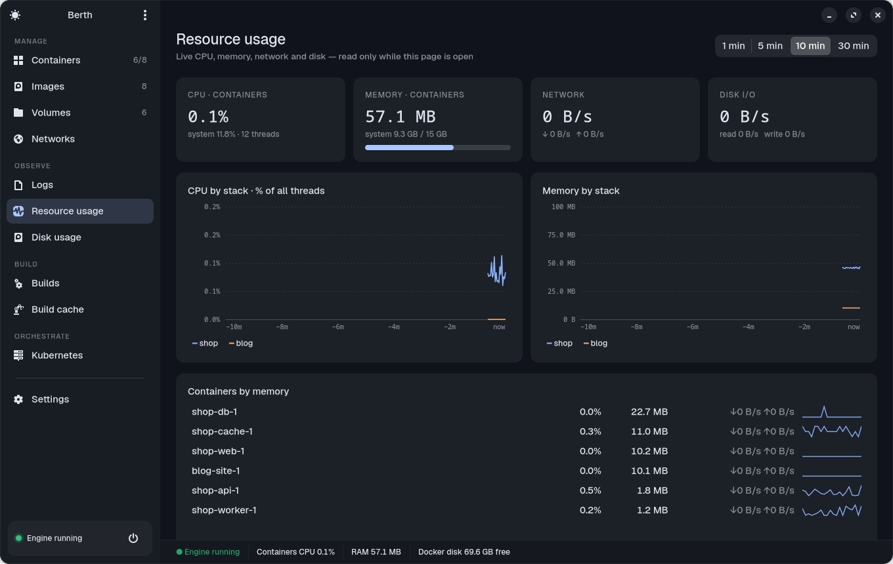
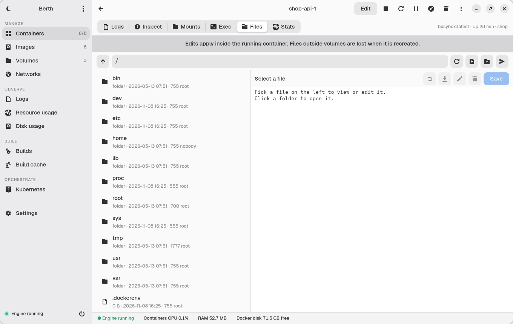
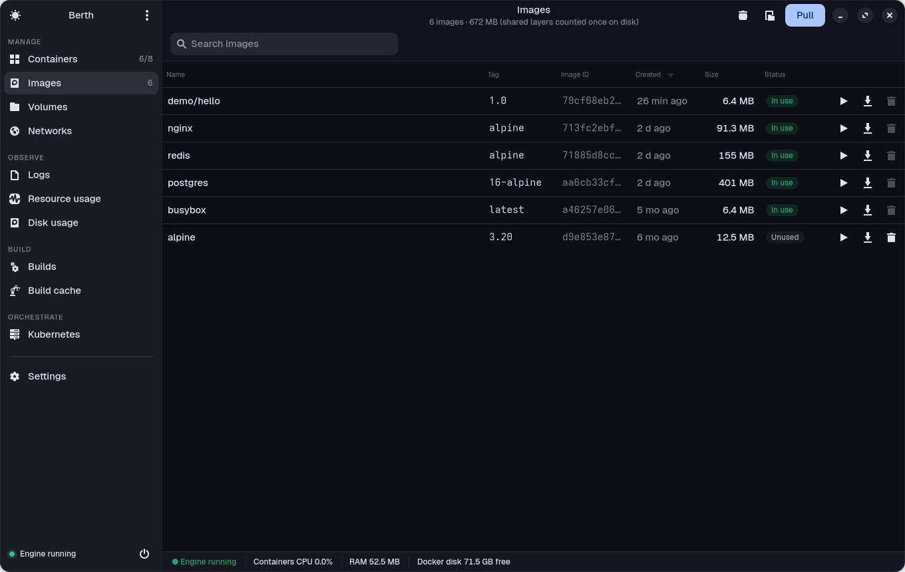

<div align="center">



# Berth

**軽量・ネイティブ・オープンソースの Docker デスクトップアプリ。**<br>
Docker Desktop のダッシュボードで日常的に使う機能はそのままに、仮想マシンも常駐サービスも、何 GB ものメモリも要りません。

[](https://github.com/subhadeeproy3902/open-docker-app/releases/latest)
[](https://github.com/subhadeeproy3902/open-docker-app/actions/workflows/build.yml)
[](LICENSE)


[English](README.md) · [简体中文](README.zh-CN.md) · **日本語**



</div>

---

## なぜ Berth？

Linux にはすでに Docker Engine があります。それでも Docker Desktop は**専用の仮想マシン**を追加で動かし、バックエンドを常駐させ、最低 4 GB のメモリを求めます。Berth は逆のアプローチです。

- 🪶 **とても軽い**：ウィンドウ表示中のメモリは **約 110 MB**、インストールサイズは **約 1 MB**、閉じれば**何も動いていません**。
- ⚡ **ネイティブで快適**：Web ビューではなく GTK 4 + libadwaita。Docker への呼び出しはすべてバックグラウンドで行うので、クリックで固まりません。
- 🔌 **エンジンへ直接接続**：Docker（システム / rootless）、Podman の Docker 互換ソケット、任意の `docker context`、リモートの `tcp://` エンジン。
- 📈 **Grafana 風の可観測性**：CPU / メモリ / ネットワーク / ディスクのライブグラフと、ログレベル別ヒストグラム付きのログエクスプローラー。
- ✏️ **見るだけでなく編集も**：環境変数・ポート・ボリューム・リソース制限、コンテナとボリューム内のファイル、compose ファイル、Kubernetes の YAML。
- 🔓 **MIT ライセンス、アカウント不要、テレメトリなし**：個人も企業も規模を問わず無料。

## Berth と Docker Desktop の比較

| | **Berth** | **Docker Desktop** |
|---|---|---|
| 動作方式 | 手元のエンジンをそのまま使用 | 専用 VM を同梱して実行（[KVM が必要][dd-linux]） |
| メモリ | 表示中 **約 110 MB**、閉じれば **0** | **最低 4 GB、推奨 8 GB**。VM だけで既定 2 GB（[ガイド][lc]） |
| ディスク | アプリ **約 1 MB**（GTK は GNOME 環境なら導入済み） | 仮想ディスク、既定 **約 64 GB**（[ガイド][ou]） |
| ウィンドウを閉じた後 | 何も動かない | VM とバックエンドが動き続ける（Resource Saver が働くまで） |
| ライブ統計 | カーネルの cgroup カウンターを読む | Docker API をポーリング |
| UI 技術 | ネイティブ GTK 4 | Electron（Chromium） |
| 価格 / ライセンス | **MIT、誰でも無料** | プロプライエタリ。大きな企業は有料サブスクリプション（[規約][dd-sub]） |
| 既存コンテナの環境変数 / ポート / ボリュームの編集 | ✅（安全な再作成、失敗時はロールバック） | ❌ |
| ボリューム内のファイル | ✅ 閲覧・**編集**・エクスポート・インポート・複製 | 閲覧、エクスポート / インポート |
| ログエクスプローラー（レベル別ヒストグラム、正規表現、複数コンテナ） | ✅ | 基本的なログ表示 |
| Compose：ファイルの実行、pull して再作成、**compose ファイルの編集** | ✅ | 開始 / 停止 / 削除 |
| イメージの脆弱性スキャン | ✅（オープンソースの Trivy） | ✅（Docker Scout、アカウント必要） |
| Kubernetes | ✅ 任意の kubeconfig + kind のローカルクラスター | ✅ 内蔵クラスター |
| Podman / リモートエンジン | ✅ | ❌ |

[dd-linux]: https://docs.docker.com/desktop/setup/install/linux/
[lc]: https://linuxconfig.org/how-to-install-docker-desktop-on-ubuntu-26-04
[ou]: https://oneuptime.com/blog/post/2026-02-08-how-to-use-docker-desktop-resource-management-settings/view
[dd-sub]: https://www.docker.com/pricing/

## どれくらい軽い？

[`tools/bench.py`](tools/bench.py) で、i5-12450H のノート PC・稼働中コンテナ 6 個の環境で計測（方法は [docs/BENCHMARKS.md](docs/BENCHMARKS.md)）：

| 項目 | Berth |
|---|---|
| 起動からウィンドウ表示まで | **約 1.2 秒** |
| メモリ (RSS) | **108 MB** |
| ライブ統計表示中の CPU | **1 コアの 0.4 %** |
| ウィンドウ非フォーカス時（リソースセーバー） | **1 コアの約 0.1 %** |
| ウィンドウを閉じた後 | **0 / 0**（プロセスが終了） |
| インストールサイズ | **約 1 MB**（リリース tarball は約 260 KB） |

## 機能

| | |
|---|---|
|  **ログエクスプローラー**：レベル別に色分けしたヒストグラム、ドラッグで時間ズーム、ライブ / 5 分 … 7 日、レベル別フィルターと件数、正規表現検索。 |  **リソース使用量**：Compose プロジェクトごとの CPU とメモリのライブグラフ、合計、重いコンテナ一覧。 |
|  **ファイル**：実行中コンテナやボリューム内のファイルを閲覧・**編集**、アップロード、ダウンロード、名前変更、削除。 |  **イメージ**：Docker Hub の検索と pull、ポート / 環境変数付きで実行、脆弱性スキャン、タグ付け、push、保存 / 読み込み。 |

ほかにも：Compose ごとのコンテナ管理、Exec の内蔵ターミナル（VTE）、コンテナの編集（安全な再作成）、Compose の実行 / 編集、ボリュームのエクスポート・インポート・複製、ネットワークの接続 / 切断、ビルド履歴とビルドキャッシュ、ディスク使用量、Kubernetes（Pod / Deployment / Service / Node、YAML 編集、kind のローカルクラスター）、エンジン切り替え（Docker / rootless / Podman / context / tcp）、レジストリへのサインイン、任意のトレイアイコン、ライト / ダークテーマ、アクセシビリティ設定（文字サイズ 85–150 %、表示密度 コンパクト / 標準 / ゆったり、くっきりした枠線とコントラスト、大きいアイコン、アニメーションを減らす）。

## インストール

### Linux

**どのディストリビューションでもコマンド 1 つ**（パッケージマネージャーで GTK 4 / libadwaita / PyGObject を入れてから Berth をユーザー領域へ。Ubuntu 24.04 など古い環境では自動で Flatpak に切り替えます）：

```sh
curl -fsSL https://raw.githubusercontent.com/subhadeeproy3902/open-docker-app/main/scripts/install.sh | sh
```

**Flatpak**（すべてのディストリビューションで動作）：

```sh
curl -LO https://github.com/subhadeeproy3902/open-docker-app/releases/latest/download/berth.flatpak
flatpak install --user berth.flatpak
```

**Arch Linux**：`git clone https://github.com/subhadeeproy3902/open-docker-app && cd open-docker-app/packaging/arch && makepkg -si`

**ソースから**：`git clone https://github.com/subhadeeproy3902/open-docker-app && cd open-docker-app && make install-user`

Docker ソケットへのアクセス権が必要です：`sudo usermod -aG docker $USER`（再ログイン）、または rootless Docker / Podman を利用してください。

### macOS

> 詳しい手順：**[docs/INSTALL-macOS.md](docs/INSTALL-macOS.md)**（Apple アカウントも支払いも不要）。

[最新リリース](https://github.com/subhadeeproy3902/open-docker-app/releases/latest) から **`Berth-macos-arm64.dmg`** をダウンロードし、アプリケーションフォルダへドラッグします。まだ公証されていないため、初回は次を実行してください：

```sh
xattr -dr com.apple.quarantine /Applications/Berth.app
```

Mac では Docker エンジンが必要です：**Colima**（`brew install colima docker && colima start`）、OrbStack、Rancher Desktop、Docker Desktop。ソケットは自動で見つけます。

### Windows

> 詳しい手順：**[docs/INSTALL-Windows.md](docs/INSTALL-Windows.md)**（コード署名証明書は不要）。

[最新リリース](https://github.com/subhadeeproy3902/open-docker-app/releases/latest) から **`Berth-windows-x64.zip`** をダウンロードして展開し、`Berth.exe` を実行。TCP でエンジンに接続します（Docker Desktop：*Settings → General → Expose daemon on tcp://localhost:2375*）。現時点で最も快適なのは **WSL 2** 内で Linux 版を動かす方法です（WSLg がウィンドウを表示します）。

## キーボードショートカット

<kbd>Ctrl</kbd>+<kbd>F</kbd> 検索 · <kbd>Ctrl</kbd>+<kbd>1</kbd>…<kbd>9</kbd> ページ切り替え · <kbd>Ctrl</kbd>+<kbd>,</kbd> 設定 · <kbd>Ctrl</kbd>+<kbd>S</kbd> 保存 · <kbd>Ctrl</kbd>+<kbd>Q</kbd> 終了

## よくある質問

**Berth は Docker の代わりになりますか？** いいえ。Berth は Docker Engine（または Podman）のためのデスクトップアプリです。`docker` や `docker compose` はこれまで通り使えます。

**Docker Desktop は必要ですか？** 不要です。それこそが Berth の存在理由です。

**データを送信しますか？** テレメトリなし、アカウント不要。接続するのはエンジンと、操作したときの Docker Hub・レジストリ・Trivy の脆弱性データベースだけです。

## ロードマップ

署名・公証済みの macOS 版と Windows の MSI インストーラー · Flathub と AUR への登録 · Windows の名前付きパイプ対応 · SSH リモートエンジン · ボリュームの定期バックアップ · イメージレイヤーエクスプローラー · Compose の依存グラフ · リソースアラート · Kubernetes リソースの拡充 · UI の多言語化（中国語、日本語 …）

## コントリビュート

どんな規模の貢献も歓迎します。[CONTRIBUTING.md](CONTRIBUTING.md) と [行動規範](CODE_OF_CONDUCT.md) をご覧ください。セキュリティの問題は [SECURITY.md](SECURITY.md) へ。

## ライセンス

[MIT](LICENSE) © 2026 [Berth コントリビューター](https://github.com/subhadeeproy3902/open-docker-app/graphs/contributors)。

*Docker および Docker のロゴは Docker, Inc. の商標または登録商標です。Berth は独立したオープンソースプロジェクトであり、Docker, Inc. とは提携・承認・後援の関係にありません。*

<div align="center">

Berth でメモリが浮いたら、⭐ でほかの人にも届けてください。

</div>
