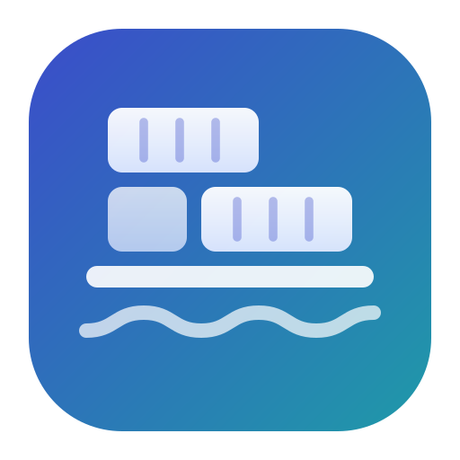
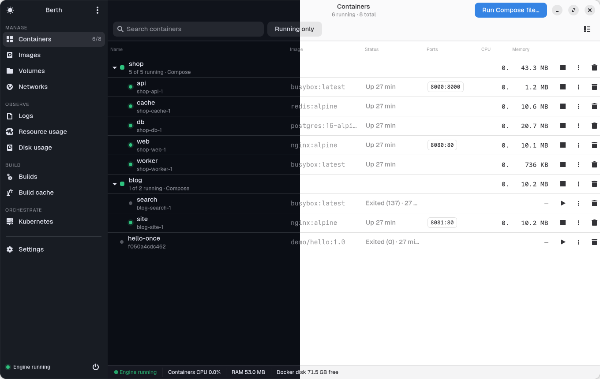
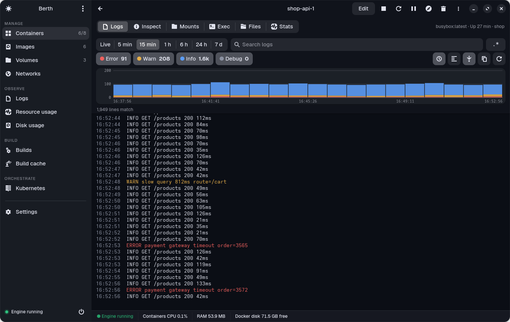
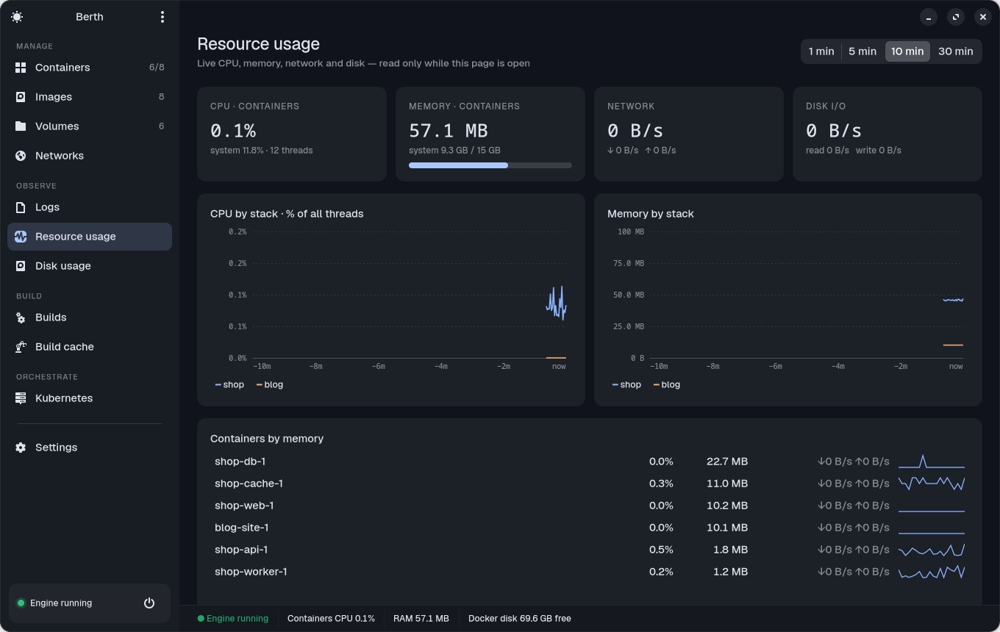
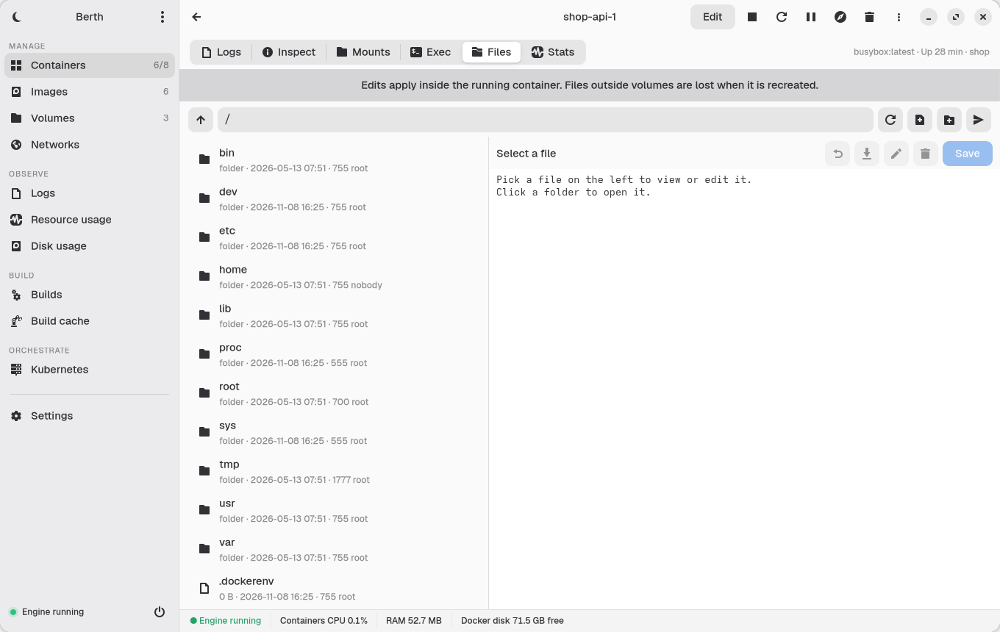
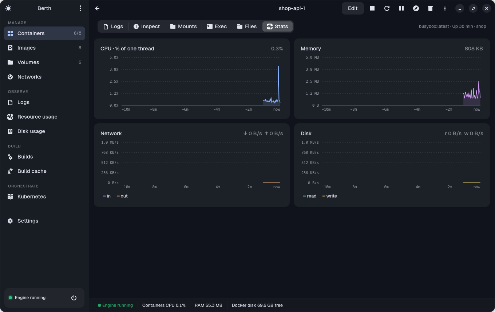
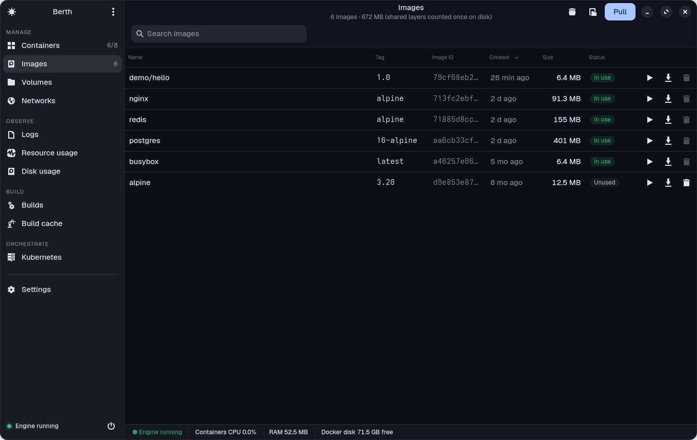
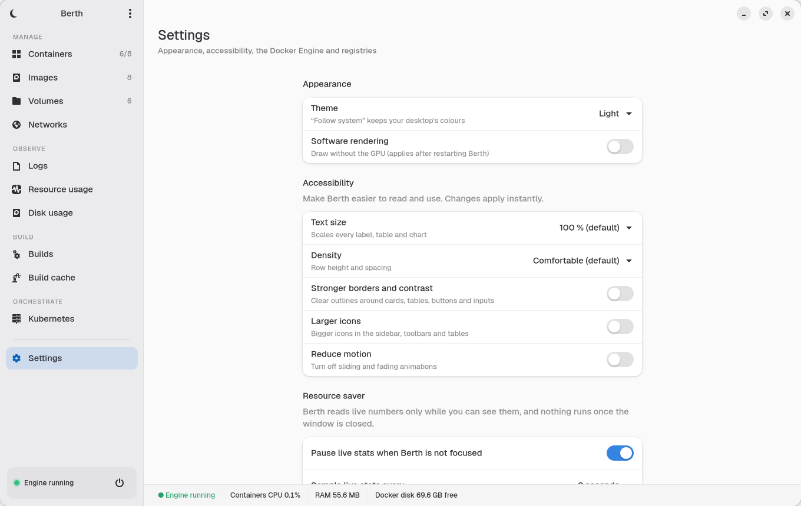
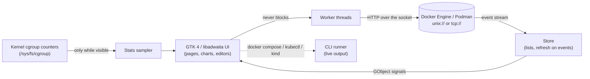

<div align="center">



# Berth

**A light, native, open-source desktop app for Docker.**<br>
Everything you use Docker Desktop's dashboard for — without the virtual machine, the background service or the gigabytes of RAM.

[](https://github.com/subhadeeproy3902/open-docker-app/releases/latest)
[](https://github.com/subhadeeproy3902/open-docker-app/actions/workflows/build.yml)
[](LICENSE)


**English** · [简体中文](README.zh-CN.md) · [日本語](README.ja.md)



</div>

---

## Contents

- [Why Berth](#why-berth)
- [Berth vs Docker Desktop](#berth-vs-docker-desktop)
- [How light is it?](#how-light-is-it)
- [Features](#features)
- [Install](#install) — [Linux](#linux) · [macOS](#macos) · [Windows](#windows)
- [Quick start](#quick-start)
- [Keyboard shortcuts](#keyboard-shortcuts)
- [FAQ](#faq)
- [How it works](#how-it-works)
- [Roadmap](#roadmap)
- [Contributing](#contributing) · [License](#license)

## Why Berth

On Linux you already have a Docker Engine. Docker Desktop still installs **its own virtual machine** next to it,
keeps a backend service running, and asks for at least 4 GB of RAM. Berth is the opposite approach:

- 🪶 **Tiny** — about **110 MB of RAM** while the window is open, **~1 MB** installed, **nothing** running once you close it.
- ⚡ **Native and fast** — GTK 4 + libadwaita, not a web view. Every Docker call runs in the background, so a click never freezes the window.
- 🔌 **Talks straight to your engine** — Docker (system or rootless), Podman's Docker-compatible socket, any `docker context`, or a remote `tcp://` engine.
- 📈 **Grafana-style observability built in** — live CPU / memory / network / disk graphs and a log explorer with a level histogram.
- ✏️ **Edit, not just look** — environment variables, ports, volumes, limits, files inside containers and volumes, compose files, Kubernetes YAML.
- 🔓 **MIT licensed, no account, no telemetry** — free for everyone, including companies of any size.

## Berth vs Docker Desktop

| | **Berth** | **Docker Desktop** |
|---|---|---|
| How it runs Docker | Uses the engine you already have | Ships and runs its own VM ([needs KVM virtualisation][dd-linux]) |
| RAM | **~110 MB** while open, **0** when closed | **4 GB minimum, 8 GB recommended**; the VM alone takes 2 GB by default ([guide][lc]) |
| Disk | **~1 MB** app (+ GTK, already on GNOME/KDE-GTK desktops) | Virtual disk image, **~64 GB** by default ([guide][ou]) |
| When the window is closed | Nothing runs | VM + backend keep running (until Resource Saver kicks in) |
| Live stats | Kernel cgroup counters — a few file reads | Docker API polling |
| UI technology | Native GTK 4 | Electron (Chromium) |
| Price / license | **MIT, free for everyone** | Proprietary; paid subscription for larger companies ([terms][dd-sub]) |
| Source code | Open | Closed |
| Containers, logs, exec, files, stats | ✅ | ✅ |
| Edit env / ports / volumes of an existing container | ✅ (safe recreate with rollback) | ❌ |
| Files inside containers | ✅ browse, edit, upload, download | ✅ |
| Files inside volumes | ✅ browse, **edit**, export, import, clone | Browse, export / import |
| Log explorer with level histogram, regex, multi-container | ✅ | Basic log view |
| Compose: run a compose file, pull & recreate, **edit the compose file** | ✅ | Start / stop / delete stacks |
| Image vulnerability scan | ✅ (Trivy, open source) | ✅ (Docker Scout, account) |
| Kubernetes | ✅ any kubeconfig + local clusters via kind | ✅ built-in cluster |
| Podman / remote engines | ✅ | ❌ |
| Extensions marketplace, Docker AI | ❌ (not planned) | ✅ |

[dd-linux]: https://docs.docker.com/desktop/setup/install/linux/
[lc]: https://linuxconfig.org/how-to-install-docker-desktop-on-ubuntu-26-04
[ou]: https://oneuptime.com/blog/post/2026-02-08-how-to-use-docker-desktop-resource-management-settings/view
[dd-sub]: https://www.docker.com/pricing/

> Docker Desktop figures are from Docker's documentation and the guides linked above. Berth figures are measured — see below.

## How light is it?

Measured with [`tools/bench.py`](tools/bench.py) on an i5-12450H laptop with 6 running containers
(method and raw numbers: [docs/BENCHMARKS.md](docs/BENCHMARKS.md)):

| What | Berth |
|---|---|
| Window ready after launch | **~1.2 s** |
| Memory (RSS) | **108 MB** |
| CPU while showing live stats | **0.4 % of one core** |
| CPU when the window is not focused (resource saver) | **~0.1 % of one core** |
| CPU / RAM after closing the window | **0 / 0** (the process exits) |
| Installed size | **~1 MB** (release tarball: ~260 KB) |

```text
Memory used while working
  Berth (whole app)                ██                                         0.11 GB
  Docker Desktop (VM, default)     ████████████████████████████████████████   2 GB    + the Electron UI and backend
```

What keeps it light: lists update from Docker's **event stream** (health-check noise filtered out) instead of polling;
rows update in place; live stats are read only **while you can see them**; charts redraw only when a new sample
arrives; there are no animations or timers while idle. A *Software rendering* switch draws without the GPU at all.

## Features

| | |
|---|---|
|  **Log explorer** — Loki/Grafana-style histogram coloured by level, drag to zoom, Live / 5 min … 7 days, level filters with counts, regex search, per-container colours. |  **Resource usage** — live CPU and memory per Compose project (1–30 min), totals, heaviest containers with sparklines. |
|  **Files** — browse, view and **edit** files in running containers and in volumes; upload, download, rename, delete. |  **Per-container stats** — CPU, memory, network and disk graphs with hover values. |
|  **Images** — in use / unused / dangling, Docker Hub search & pull with progress, run with ports/env/volumes, vulnerability scan, tag, push, save / load. |  **Settings** — light / dark / system theme, **accessibility** (text size 85–150 %, compact / comfortable / spacious density, stronger borders and contrast, larger icons, reduce motion), resource saver, engine switcher, registry sign-in, `daemon.json` editor, optional tray icon. |

**Everything else**

- **Containers** grouped by Compose project; start / stop / restart / pause / delete one container or a whole stack; ports open in your browser.
- **Container details**: Logs · Inspect (environment values hidden until you ask) · Mounts · **Exec** (built-in terminal with VTE) · Files · Stats.
- **Edit a container**: name, restart policy, CPU and memory limits and networks apply instantly; env, ports, volumes, command and image through a safe recreate.
- **Compose**: run any compose file (build / pull / profiles), up, pull & recreate, edit the compose file (with a backup), down — output streams live.
- **Volumes**: sizes, create, browse and edit files, **export** to `.tar.gz`, **import**, **clone**, delete only after typing the name.
- **Networks**: create, connect and disconnect containers, delete unused.
- **Builds**: build history with status, steps, cache hits, duration and full logs; build cache with one-click clearing.
- **Disk usage**: how full the drive holding Docker's data is, and what is reclaimable.
- **Kubernetes**: pods, deployments, services and nodes for any kubeconfig context; logs, shell, describe, scale, rollout restart, port-forward, cordon, **edit YAML and apply**; create / delete local clusters with kind.
- **Engines**: Docker (system / rootless), Podman, `docker context`s, remote `tcp://` engines; Docker Desktop, Colima, OrbStack and Rancher Desktop sockets on macOS.
- **Registries**: sign in to Docker Hub or any registry (stored by Docker's own credential store).
- **Tray icon** (optional, off by default).

## Install

### Linux

**Any distribution — one command** (installs GTK 4 / libadwaita / PyGObject with your package manager, then Berth for your user;
on older systems such as Ubuntu 24.04 it switches to the Flatpak automatically):

```sh
curl -fsSL https://raw.githubusercontent.com/subhadeeproy3902/open-docker-app/main/scripts/install.sh | sh
```

Tested on Arch / EndeavourOS, Debian 13, Fedora 45 and Ubuntu 24.04 (Flatpak path). Also handles openSUSE, Alpine, Void, Solus and Gentoo.

**Flatpak** (works everywhere, brings its own GTK):

```sh
curl -LO https://github.com/subhadeeproy3902/open-docker-app/releases/latest/download/berth.flatpak
flatpak install --user berth.flatpak
```

**Arch Linux** (from [`packaging/arch/PKGBUILD`](packaging/arch/PKGBUILD)):

```sh
git clone https://github.com/subhadeeproy3902/open-docker-app && cd open-docker-app/packaging/arch && makepkg -si
```

**From source**:

```sh
git clone https://github.com/subhadeeproy3902/open-docker-app && cd open-docker-app
make install-user        # into ~/.local, no root   (system-wide: sudo make install PREFIX=/usr/local)
```

Your user needs access to the Docker socket: `sudo usermod -aG docker $USER` (log out and back in), or use rootless Docker / Podman.

### macOS

> Full step-by-step guide: **[docs/INSTALL-macOS.md](docs/INSTALL-macOS.md)** (no Apple account or payment needed).

Download **`Berth-macos-arm64.dmg`** from the [latest release](https://github.com/subhadeeproy3902/open-docker-app/releases/latest),
drag Berth into Applications. The app is not notarized yet, so the first time run:

```sh
xattr -dr com.apple.quarantine /Applications/Berth.app
```

Berth needs a Docker engine on the Mac: **Colima** (`brew install colima docker && colima start`), OrbStack, Rancher Desktop or
Docker Desktop. It finds their sockets automatically. From source instead: `brew install gtk4 libadwaita pygobject3 adwaita-icon-theme`,
then `python3 -m berth` in a clone.

### Windows

> Full step-by-step guide: **[docs/INSTALL-Windows.md](docs/INSTALL-Windows.md)** (no certificate needed).

Download **`Berth-windows-x64.zip`** from the [latest release](https://github.com/subhadeeproy3902/open-docker-app/releases/latest),
unzip, run `Berth.exe`. Connect it to an engine over TCP:

- Docker Desktop: *Settings → General → Expose daemon on tcp://localhost:2375 without TLS* (Berth uses that address by default), or
- Docker Engine inside WSL 2 listening on `tcp://localhost:2375`.

The smoothest Windows experience today is running the **Linux build inside WSL 2** (WSLg shows the window):
`curl -fsSL https://raw.githubusercontent.com/subhadeeproy3902/open-docker-app/main/scripts/install.sh | sh` in your WSL distro.

> macOS and Windows builds are produced and smoke-tested automatically by GitHub Actions; they are newer than the Linux build — please [report anything odd](https://github.com/subhadeeproy3902/open-docker-app/issues/new/choose).

### Uninstall

```sh
sh scripts/install.sh --uninstall      # or: make uninstall-user   ·   flatpak uninstall io.github.subhadeeproy3902.Berth
```

## Quick start

1. Open **Berth** from your app menu (or run `berth`). The first time, a short **welcome** finds your engines, tells you
   exactly what is missing (engine stopped, no permission, not installed) and can start the engine for you. It also
   offers a sample container to try. Reopen it any time from the menu → **Welcome tour**.
2. If the engine is stopped later, press **Start Docker Engine** (Linux asks for your password through polkit).
3. Click a container for its logs, terminal, files and graphs; use the **⋮** menu for edit, export, save-as-image and more.
4. Want another engine? **Settings → Docker Engine → Connected engine** lists the ones Berth found (Docker, rootless, Podman, contexts).

## Keyboard shortcuts

| Keys | Action |
|---|---|
| <kbd>Ctrl</kbd>+<kbd>F</kbd> | Search the current page |
| <kbd>Ctrl</kbd>+<kbd>1</kbd> … <kbd>9</kbd> | Containers · Images · Volumes · Networks · Logs · Resource usage · Disk usage · Builds · Build cache |
| <kbd>Ctrl</kbd>+<kbd>,</kbd> | Settings |
| <kbd>Ctrl</kbd>+<kbd>S</kbd> | Save (file and compose editors) |
| <kbd>Ctrl</kbd>+<kbd>Q</kbd> | Quit |

## FAQ

**Does Berth replace Docker?** No. Berth is a desktop app *for* the Docker Engine (or Podman). You keep using `docker`, `docker compose` and your existing setup.

**Do I need Docker Desktop?** No — that's the point. On Linux, install Docker Engine (or Podman) and Berth. On macOS, Colima or OrbStack are lightweight engines.

**Does it phone home?** No telemetry, no account, no network access except to your engine and — when you ask — Docker Hub search, image pulls, registry sign-in and the Trivy database.

**Why is the scanner a container?** Trivy runs as `aquasec/trivy` so nothing is installed on your system; its database is cached in the `berth-trivy-cache` volume.

**Editing env vars recreates the container — is that safe?** Docker can't change those on a live container, so Berth stops it, starts a replacement with the same networks, labels and volumes, and only then removes the old one. Any failure restores the old container. Data in volumes is kept. For Compose projects, also update the compose file (Berth reminds you).

**Is Berth affiliated with Docker, Inc.?** No — see the [trademark note](#license).

## How it works



Pure Python (standard library + PyGObject), no web view, no Electron, no extra daemons. Module map and design
notes: [docs/ARCHITECTURE.md](docs/ARCHITECTURE.md).

## Roadmap

- [ ] Signed + notarized macOS build, signed Windows installer (MSI)
- [ ] Flathub and AUR listings
- [ ] Native Windows named-pipe support (no TCP setting needed)
- [ ] SSH remote engines (`ssh://` contexts)
- [ ] Volume backup schedules and snapshot/restore
- [ ] Image layer explorer (files per layer, wasted space)
- [ ] Compose graph view (services, networks, volumes, depends_on)
- [ ] Container resource alerts (notify when CPU/memory crosses a threshold)
- [ ] More Kubernetes resources (ConfigMaps, Secrets, Ingress, Jobs)
- [ ] Translations of the app UI (Chinese, Japanese, …)

Ideas and votes welcome in [Issues](https://github.com/subhadeeproy3902/open-docker-app/issues).

## Contributing

Contributions of every size are welcome — read [CONTRIBUTING.md](CONTRIBUTING.md) (dev setup, the off-screen UI tests,
style) and our [Code of Conduct](CODE_OF_CONDUCT.md). Security issues: [SECURITY.md](SECURITY.md).

```sh
git clone https://github.com/subhadeeproy3902/open-docker-app && cd open-docker-app
python3 -m berth            # run from the source tree
make check                  # syntax check · tests: see CONTRIBUTING.md
```

## License

[MIT](LICENSE) © 2026 [The Berth contributors](https://github.com/subhadeeproy3902/open-docker-app/graphs/contributors).

Berth stands on the shoulders of [GTK](https://gtk.org), [libadwaita](https://gnome.pages.gitlab.gnome.org/libadwaita/),
[PyGObject](https://pygobject.gnome.org), [VTE](https://gitlab.gnome.org/GNOME/vte), [Trivy](https://trivy.dev) and [kind](https://kind.sigs.k8s.io).

*Docker and the Docker logo are trademarks or registered trademarks of Docker, Inc. Berth is an independent open-source
project and is not affiliated with, endorsed by or sponsored by Docker, Inc.*

<div align="center">

If Berth saves you some RAM, a ⭐ helps others find it.

[](https://star-history.com/#subhadeeproy3902/open-docker-app&Date)

</div>
