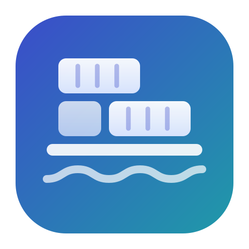
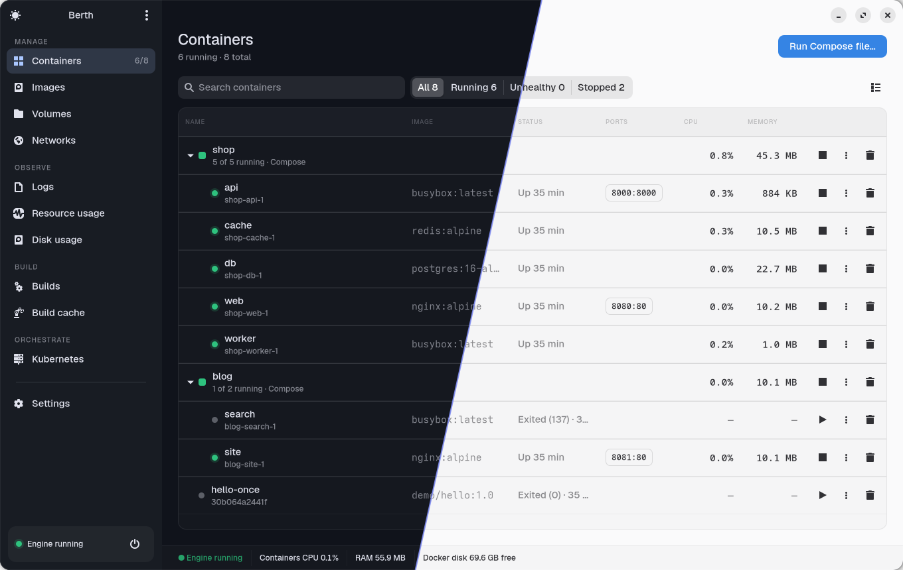
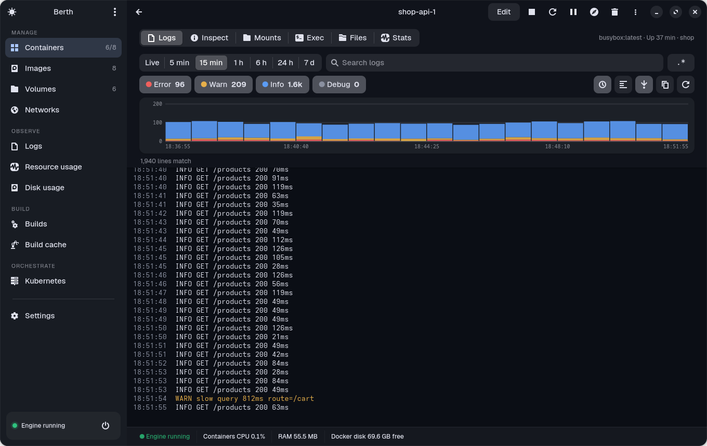
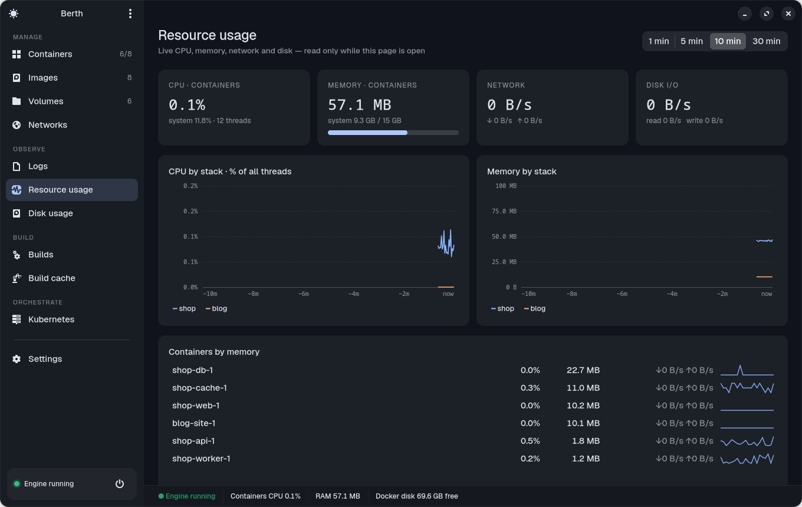
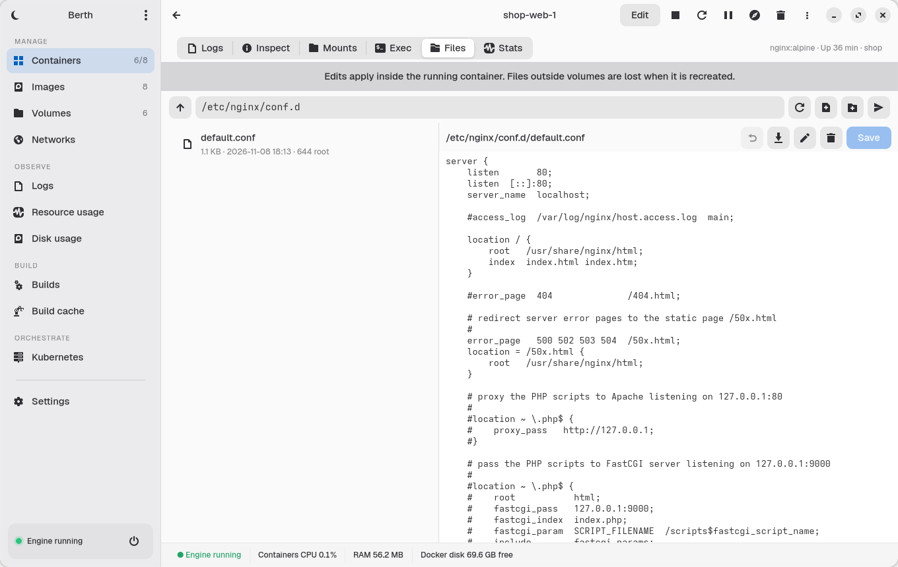
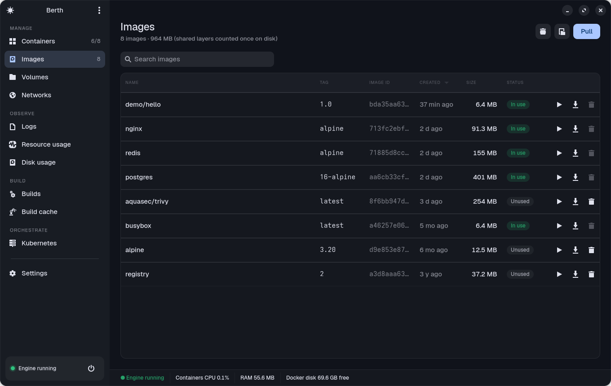

<div align="center">



# Berth

**轻量、原生、开源的 Docker 桌面应用。**<br>
Docker Desktop 控制面板的日常功能它都有 —— 却没有虚拟机、没有常驻后台服务，也不吃掉好几个 GB 的内存。

[](https://github.com/subhadeeproy3902/open-docker-app/releases/latest)
[](https://github.com/subhadeeproy3902/open-docker-app/actions/workflows/build.yml)
[](LICENSE)


[English](README.md) · **简体中文** · [日本語](README.ja.md)



</div>

---

## 为什么选择 Berth

在 Linux 上你本来就有 Docker Engine。Docker Desktop 仍然会在旁边**再装一台虚拟机**、常驻一个后台服务，并要求至少 4 GB 内存。Berth 反其道而行：

- 🪶 **极小**：窗口打开时约 **110 MB 内存**，安装体积约 **1 MB**，关闭窗口后**什么都不运行**。
- ⚡ **原生且流畅**：GTK 4 + libadwaita，而不是网页视图。所有 Docker 调用都在后台线程执行，点击永远不会卡住界面。
- 🔌 **直连你的引擎**：Docker（系统或 rootless）、Podman 的 Docker 兼容 socket、任意 `docker context`，或远程 `tcp://` 引擎。
- 📈 **内置 Grafana 风格的可观测性**：实时 CPU / 内存 / 网络 / 磁盘图表，以及带日志级别直方图的日志浏览器。
- ✏️ **不只是查看，还能编辑**：环境变量、端口、数据卷、资源限制、容器与数据卷里的文件、compose 文件、Kubernetes YAML。
- 🔓 **MIT 许可，无需账号，无遥测**：个人和任何规模的公司都可免费使用。

## Berth 与 Docker Desktop 对比

| | **Berth** | **Docker Desktop** |
|---|---|---|
| 运行方式 | 使用你已有的引擎 | 自带并运行一台虚拟机（[需要 KVM][dd-linux]） |
| 内存 | 打开时 **约 110 MB**，关闭后 **0** | **最低 4 GB，推荐 8 GB**；虚拟机默认就占 2 GB（[指南][lc]） |
| 磁盘 | 应用 **约 1 MB**（GTK 在 GNOME 桌面上通常已安装） | 虚拟磁盘镜像，默认 **约 64 GB**（[指南][ou]） |
| 关闭窗口后 | 不运行任何东西 | 虚拟机与后台服务继续运行（直到 Resource Saver 生效） |
| 实时统计 | 读取内核 cgroup 计数器 | 轮询 Docker API |
| 界面技术 | 原生 GTK 4 | Electron（Chromium） |
| 价格 / 许可 | **MIT，人人免费** | 专有软件；较大公司需付费订阅（[条款][dd-sub]） |
| 编辑现有容器的环境变量 / 端口 / 数据卷 | ✅（安全重建，失败自动回滚） | ❌ |
| 数据卷内文件 | ✅ 浏览、**编辑**、导出、导入、克隆 | 浏览、导出 / 导入 |
| 日志浏览器（级别直方图、正则、多容器） | ✅ | 基础日志视图 |
| Compose：运行文件、拉取并重建、**编辑 compose 文件** | ✅ | 启动 / 停止 / 删除 |
| 镜像漏洞扫描 | ✅（开源 Trivy） | ✅（Docker Scout，需账号） |
| Kubernetes | ✅ 任意 kubeconfig + kind 本地集群 | ✅ 内置集群 |
| Podman / 远程引擎 | ✅ | ❌ |

[dd-linux]: https://docs.docker.com/desktop/setup/install/linux/
[lc]: https://linuxconfig.org/how-to-install-docker-desktop-on-ubuntu-26-04
[ou]: https://oneuptime.com/blog/post/2026-02-08-how-to-use-docker-desktop-resource-management-settings/view
[dd-sub]: https://www.docker.com/pricing/

## 有多轻？

使用 [`tools/bench.py`](tools/bench.py) 在 i5-12450H 笔记本、6 个运行中容器的环境下测得（方法见 [docs/BENCHMARKS.md](docs/BENCHMARKS.md)）：

| 项目 | Berth |
|---|---|
| 启动到窗口就绪 | **约 1.2 秒** |
| 内存 (RSS) | **108 MB** |
| 显示实时统计时的 CPU | **单核 0.4 %** |
| 窗口未聚焦时（资源节省模式） | **单核约 0.1 %** |
| 关闭窗口后 | **0 / 0**（进程直接退出） |
| 安装体积 | **约 1 MB**（发布包 172 KB） |

## 功能

| | |
|---|---|
|  **日志浏览器**：按级别着色的直方图、拖动缩放时间、实时 / 5 分钟 … 7 天、级别过滤与计数、正则搜索。 |  **资源使用**：按 Compose 项目显示实时 CPU 与内存、总量、最占资源的容器。 |
|  **文件**：浏览、查看并**编辑**运行中容器和数据卷里的文件；上传、下载、重命名、删除。 |  **镜像**：Docker Hub 搜索与拉取、带端口/环境变量运行、漏洞扫描、打标签、推送、保存 / 加载。 |

另外还有：按 Compose 分组的容器管理、Exec 内置终端（VTE）、容器编辑（安全重建）、Compose 运行/编辑、数据卷导出导入克隆、网络连接与断开、构建历史与构建缓存、磁盘占用、Kubernetes（Pod / Deployment / Service / Node、编辑 YAML、kind 本地集群）、引擎切换（Docker / rootless / Podman / context / tcp）、镜像仓库登录、可选托盘图标、浅色 / 深色主题，以及无障碍设置（文字大小 85–150 %、紧凑 / 舒适 / 宽松密度、更清晰的边框与对比度、更大的图标、减少动画）。

## 安装

### Linux

**任意发行版，一条命令**（用你的包管理器安装 GTK 4 / libadwaita / PyGObject，再为当前用户安装 Berth；在 Ubuntu 24.04 等较旧系统上会自动改用 Flatpak）：

```sh
curl -fsSL https://raw.githubusercontent.com/subhadeeproy3902/open-docker-app/main/scripts/install.sh | sh
```

**Flatpak**（所有发行版通用）：

```sh
curl -LO https://github.com/subhadeeproy3902/open-docker-app/releases/latest/download/berth.flatpak
flatpak install --user berth.flatpak
```

**Arch Linux**：`git clone https://github.com/subhadeeproy3902/open-docker-app && cd open-docker-app/packaging/arch && makepkg -si`

**源码安装**：`git clone https://github.com/subhadeeproy3902/open-docker-app && cd open-docker-app && make install-user`

当前用户需要能访问 Docker socket：`sudo usermod -aG docker $USER`（注销后重新登录），或使用 rootless Docker / Podman。

### macOS

> 详细步骤：**[docs/INSTALL-macOS.md](docs/INSTALL-macOS.md)**（无需 Apple 账号，也无需付费）。

从 [最新发布](https://github.com/subhadeeproy3902/open-docker-app/releases/latest) 下载 **`Berth-macos-arm64.dmg`**，拖入「应用程序」。应用尚未公证，首次运行前执行：

```sh
xattr -dr com.apple.quarantine /Applications/Berth.app
```

Mac 上需要一个 Docker 引擎：**Colima**（`brew install colima docker && colima start`）、OrbStack、Rancher Desktop 或 Docker Desktop，Berth 会自动找到它们的 socket。

### Windows

> 详细步骤：**[docs/INSTALL-Windows.md](docs/INSTALL-Windows.md)**（无需代码签名证书）。

从 [最新发布](https://github.com/subhadeeproy3902/open-docker-app/releases/latest) 下载 **`Berth-windows-x64.zip`**，解压后运行 `Berth.exe`，通过 TCP 连接引擎（Docker Desktop：*Settings → General → Expose daemon on tcp://localhost:2375*）。目前最顺畅的方式是在 **WSL 2** 里运行 Linux 版（WSLg 会显示窗口）。

## 快捷键

<kbd>Ctrl</kbd>+<kbd>F</kbd> 搜索 · <kbd>Ctrl</kbd>+<kbd>1</kbd>…<kbd>9</kbd> 切换页面 · <kbd>Ctrl</kbd>+<kbd>,</kbd> 设置 · <kbd>Ctrl</kbd>+<kbd>S</kbd> 保存 · <kbd>Ctrl</kbd>+<kbd>Q</kbd> 退出

## 常见问题

**Berth 会取代 Docker 吗？** 不会。Berth 是 Docker Engine（或 Podman）的桌面应用，你仍然照常使用 `docker` 与 `docker compose`。

**需要 Docker Desktop 吗？** 不需要 —— 这正是它存在的意义。

**会上传数据吗？** 没有遥测、不需要账号。只会连接你的引擎，以及在你主动操作时访问 Docker Hub、镜像仓库和 Trivy 漏洞库。

## 路线图

签名与公证的 macOS 版本、Windows MSI 安装包 · Flathub 与 AUR 上架 · Windows 命名管道 · SSH 远程引擎 · 数据卷定时备份 · 镜像层浏览器 · Compose 依赖图 · 资源告警 · 更多 Kubernetes 资源 · 界面多语言（中文、日文……）

## 参与贡献

欢迎任何规模的贡献！请阅读 [CONTRIBUTING.md](CONTRIBUTING.md) 与 [行为准则](CODE_OF_CONDUCT.md)。安全问题请见 [SECURITY.md](SECURITY.md)。

## 许可证

[MIT](LICENSE) © 2026 Subhadeep Roy 及贡献者。

*Docker 及其标志是 Docker, Inc. 的商标或注册商标。Berth 是独立的开源项目，与 Docker, Inc. 没有任何关联，也未获得其认可或赞助。*

<div align="center">

如果 Berth 帮你省下了内存，欢迎点一个 ⭐ 让更多人看到它。

</div>
