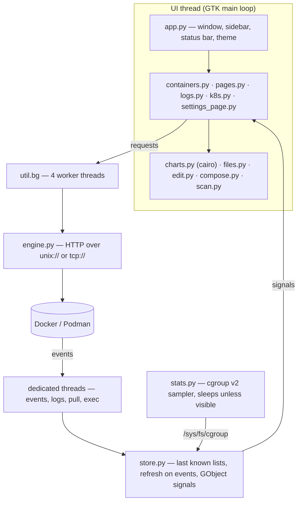

# Architecture

Berth is a single Python process: GTK 4 + libadwaita for the UI, the standard library for everything else.

## Rules that keep it fast and light

1. **The UI thread never waits on Docker.** Requests run on a small thread pool (`util.bg`) and come back with
   `GLib.idle_add`. Long streams (events, logs, pulls, exec) have their own threads.
2. **Event-driven lists.** `store.py` listens to Docker's event stream with a server-side filter; `exec_*` health-check
   events are excluded, so a busy Compose stack doesn't cause constant reloads. Requests of the same kind are coalesced.
3. **In-place updates.** Containers live in a `Gtk.TreeListModel`; when the shape is unchanged only the rows' data and
   a `changed` signal are updated, so expansion and scroll position survive. CPU / memory cells are drawn with cairo
   instead of being `Gtk.Label`s, so a new number repaints one cell instead of re-measuring the table.
4. **Stats only while visible.** `stats.py` reads `cpu.stat`, `memory.current`, `memory.stat`, `io.stat` and
   `/proc/<pid>/net/dev` — a few file reads per container — every 1–5 s, and sleeps whenever the window is hidden or
   (by default) unfocused. Without cgroup v2 (macOS / Windows / remote engines) it falls back to the Engine's one-shot stats.
5. **No idle work.** Charts redraw only when a sample arrives; there are no animations or timers while idle; closing the
   window exits the process (unless the optional tray is on).

## Platform layer (`util.py`)

`IS_LINUX / IS_MAC / IS_WIN / IN_FLATPAK`, `host()` (prefixes `flatpak-spawn --host` inside the Flatpak so `docker`,
`kubectl`, `kind` and `pkexec` run on the host), `run_in_terminal()` (Linux terminals, macOS Terminal via AppleScript,
Windows `cmd`), and `themed()` (icon fallbacks for themes that lack an icon).

## Theming (`theme.py`)

Desktops that recolour GTK 4 through `~/.config/gtk-4.0/gtk.css` (matugen, pywal, Gradience…) override libadwaita at
USER priority, which makes libadwaita's own light/dark switch invisible. When the user picks Light or Dark in Berth and
the desktop palette points the other way, Berth loads a complete Adwaita palette one step above USER priority.

## Editing a container safely (`edit.py`)

Docker can update name, restart policy and CPU / memory limits in place. Everything else needs a new container:
stop → rename the old one aside → create the replacement with the same networks, aliases, labels and volumes → start →
verify it runs → delete the old one. Any failure removes the replacement and restores the original.

## Volumes and scanning

Volume browsing, export, import and clone use a throwaway `busybox` helper container (labelled
`io.github.subhadeeproy3902.berth.helper=volume`, auto-removed). Vulnerability scans run `aquasec/trivy` as a container
with its database cached in the `berth-trivy-cache` volume.
